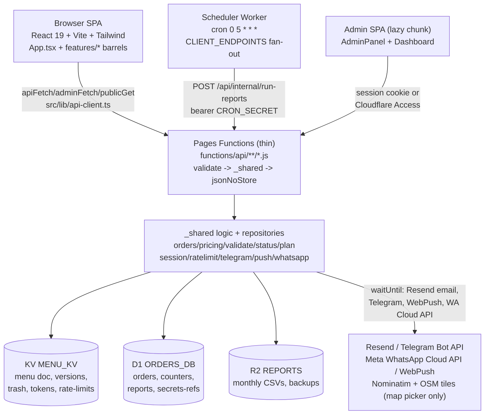

# PROJECT_OVERVIEW — Chou 3abelak (شو عبالك) white-label menu + WhatsApp ordering
Status: PRE-LAUNCH / testing phase (all data fake; free Cloudflare plan; no real traffic/incidents). Read-only discovery 2026-11-01.

## 1. One-page summary + health scores

What it is: bilingual (EN/AR, RTL) restaurant menu site with cart + WhatsApp checkout, admin panel (menu/orders/reports/backup/customer-data), monthly emailed reports, Telegram + WebPush owner notifications. Users: restaurant customers (menu/order/tracking), owners/admins (dashboard). Core flows: browse menu → cart → `POST /api/orders` (server reprices from KV menu) → WhatsApp draft or Cloud-API send → owner confirms in dashboard → customer tracks via `?track=N&t=token`.

Stack: React 19 + Vite 8 + Tailwind v4 + TS (strictNullChecks only) on Cloudflare Pages; Pages Functions (plain JS) → `functions/_shared/**` (only place with SQL) → D1 (`ORDERS_DB`), KV (`MENU_KV` menu doc + versions/trash/tokens/rate-limits), R2 (`REPORTS` CSVs/backups); standalone scheduler Worker (cron `0 5 * * *`) fans out `POST /api/internal/run-reports`.

Architecture type: modular monolith / white-label base system deployed as per-client clones (NOT multi-tenant: `docs/ADD_NEW_CLIENT.md` = `git clone` + `setup-new-client.mjs` + fresh D1+KV+R2 + env vars per client; backend untouched, only `src/config/*` + assets change).

| Axis | Score | One-line justification + evidence |
|---|---|---|
| Maintainability | 3/5 | Barrel isolation enforced and clean (depcruise 373 modules/1076 deps, 0 violations), but god files persist (`telegram.js` 998, `App.tsx` 571, two 350+ line admin panels with self-filed split TODOs). |
| Scalability | 3/5 | Stateless compute + bounded queries. REVISED 2026-11-01: one Cloudflare account PER CLIENT, so quotas are per-client (~900 orders/day/client before KV writes bind); clone model scales horizontally, but ops cost grows per account (see RF-13). |
| Testability | 3/5 | 36 custom check scripts cover pricing/parity/plans/reports/backup; `tsc` clean, parity 82/82, plan 46/46, pricing 92/0 after Phase-0 RF-01 fix — but no framework, no coverage, pre-existing failures in features/sound suites, 2 scripts need live env. |
| Operability | 2/5 | No CI, no staging, no health endpoint, no error tracker; deploy = Pages git integration; rollback = Pages rollback + KV menu snapshots. Boosthis edge timing middleware is the only instrumentation. |
| Extensibility | 3/5 | Real extension points (feature barrels, `features.config` + `SITE_PLAN` gating, single-SQL-owner repos, `ADD_NEW_FEATURE.md` checklist); paper experiments add a type/channel/report in ~8-14 files each, but order-type literals are scattered across ~8 files and pricing logic is mirrored FE/BE (parity-guarded). Details §10. |

Honest first impression: a disciplined, well-documented solo/small-team build with unusually good architectural hygiene (isolation rules, repo pattern, validation layering) for its size — held back by single-person bus factor, zero automation around deploy/verify, and a clone-per-client model whose cost is operational (one Cloudflare account + secret set per client — see RF-13) rather than a code ceiling.

## 2. Architecture diagram + components

Components: (a) Storefront shell (`App.tsx`, Header/Footer, `features/menu|cart|orders|track`) — cart state in `useShopCartState`, checkout submit in `useCartCheckoutSubmit` (hotspot, 17 changes/10d). (b) Admin console (lazy-loaded; `features/admin|reports|backup`) + customer-data tool (password + typed-word guarded, HMAC audit). (c) API layer (~53 route files; all admin routes behind `functions/api/admin/_middleware.js`: cookie-HMAC session first, Access JWT second, localhost bypass only with `ALLOW_LOCAL_DEV=1`). (d) Shared backend (`functions/_shared/`, 35 modules; SQL ONLY here, 4 repos). (e) Data: D1 (orders ledger + counters + reports + service_config refs; secrets live in `service_secrets` table + Pages secrets, never KV), KV (menu doc = price/name source of truth), R2 (CSVs/backups). (f) Scheduler (56-line fan-out, per-site secret, failure-isolated). Data flow per order: `POST /api/orders` → origin check → KV menu load → ordering-state gate (403 paused/closed/disabled) → validate+reprice server-side → idempotency (`idem_key`) → atomic `order_counter UPDATE...RETURNING` → insert → waitUntil (rate-counter KV write, push/Telegram/WhatsApp) → response reflects stored row.

## 3. Tech stack table + EOL

| Layer | Technology | Version (evidence) | EOL / note |
|---|---|---|---|
| UI | react, react-dom | 19.0.1 (`package.json:44-45`) | ASSUMPTION: supported (verify on endoflife.date) |
| Build | vite + @vitejs/plugin-react | 8.3.0 + 6.1.1 | ASSUMPTION: supported |
| CSS | tailwindcss + @tailwindcss/vite | 4.3.3 | ASSUMPTION: supported |
| Language | typescript (strictNullChecks only, NOT full strict — `tsconfig.json:29`) | 5.9.3 (7.0.2 available) | ASSUMPTION: supported |
| Anim | motion | 12.43.0 (14.9.0 available — major behind) | — |
| Icons/maps/fonts | lucide-react 0.546 (1.66 avail), leaflet 1.9.4, fontsource cairo+poppins | — | — |
| Runtime | Cloudflare Pages + Functions (workerd `compatibility_date 2025-06-01`, `wrangler.toml:6`) | — | Vendor-managed |
| DB | D1 SQLite (`ORDERS_DB`, 15 migrations, no 0002 by design) | — | Vendor-managed |
| KV / R2 | `MENU_KV`, `REPORTS` bucket | — | Vendor-managed |
| Email/push/notify | Resend (report mail), WebPush (`@mmmike/web-push` 1.5.5), Telegram Bot API, Meta WhatsApp Cloud API (`whatsapp-api.js` pins version const) | — | External SLAs UNKNOWN |
| Local runtime | node v22.22.0, npm 11.17.0 | Node 22 LTS (ASSUMPTION: maintained into 2027 — verify) | — |
| AI | @google/genai 2.30 (2.32 avail) | — | Unclear usage in app; no key in repo |

## 4. Data model + API inventory (compact)

ER (D1, from `migrations/*.sql`): `orders(id PK, number UNIQUE, idem_key UNIQUE, track_token, created_at, updated_at, status[new|confirmed|completed|cancelled], type[delivery|pickup|dinein], customer_* incl. phone_norm + location_lat/lng NULLable, items_json, subtotal/delivery_fee/total, lang, sent_via, pii_purged_at)` + indexes `(created_at),(status),(phone_norm)`; `order_counter(id=1,last_number)`; `report_settings(id=1)`; `monthly_reports(month PK,…)`; `service_config/service_secrets(key…)` (WA + Telegram link refs); `telegram_pairing_codes`, `telegram_notifications(order_id PK)`; `client_access/client_user_status`, `admin_push`, order-tracking-push tables (0007-0011). KV: `menu` doc, `menu:ver:*` (50 latest + 1/day 60d), `menu:trash`, `import:<token>` (15-min single-use), `login:fail:<ip>`, `order:ip:<ip>`, WA cap counters. No soft-delete columns (trash is KV-side); no multi-tenancy columns (isolation = separate D1/KV/R2 per client clone). Audit: HMAC entries (`AUDIT_SECRET`) for customer-data actions.

Routes (method/path/auth/purpose; response = `jsonNoStore`, no OpenAPI spec — grep found none):
Public: `GET /api/menu` | `POST /api/orders` (origin+rate-limit+idempotency) | `GET /api/ordering-state` | `GET /api/track*` (`/track`, `/track/received`, `/track/cancel` — token-gated) | `GET /api/privacy-info` | `GET /api/reports/confirm?token=` | `POST /api/push-subscribe` + `GET /api/push-key` | `POST /api/telegram/webhook` (secret-verified) | `POST /api/internal/run-reports` + `/order-nag` (bearer `CRON_SECRET`, else 404) | auth `POST /api/auth/login|logout`, `GET /api/auth/session`.
Admin (session or Access JWT; plan-gated 404s via `hasFeature`): `menu` (PUT snapshots previous), `orders` (+`[id]`, windowed `days|from/to`, limit ≤2000), `reports` (+`[month]`, `report-settings`+`/test|/resend`), `backup/*` (export/csv/print/auto), `import/analyze|apply`, `versions*` (+`[id]/restore|changes`), `trash*`, `ordering/pause|enabled`, `customer-data/search|action|status`, `clients/*`, `invites/*`, `activity`, `whatsapp`, `telegram`, `push-subscriptions`.
Background/queues: no queue; `context.waitUntil()` chains inside request (rate-counter, push, Telegram, WA send); daily cron Worker does retention + report generation + weekly backup mail. Heavy work stays out of the hot path except the awaited WA owner-send (8s timeout, fail-over to wa.me) — by design (client needs `sentVia`).

## 5. Metrics table

| Metric | Value | Evidence |
|---|---|---|
| App LOC / files | 39,565 lines / 323 files (`src` 23,017/165; `functions` 11,010/91; `scripts` 5,196/49; `scheduler` 61/2; `migrations` 281/16) | `raw/02-loc.txt` |
| Sidecars (excluded) | tour-export 5,828 lines/18 files; remotion-video 167,809 lines/44 files | same |
| Largest files | telegram.js 998; IdentitySection.tsx 573; App.tsx 571; OrdersBell.tsx 546 | same |
| Complexity (instrumental) | tsc clean; eslint NOT RUN (120s timeout); radon/jscpd NOT RUN (not installed) | `raw/04-quality.txt` |
| Duplication (manual) | Pricing mirrored FE↔BE in 6 files (`src/utils/pricing*.ts` ×3 + `functions/_shared/pricing*.js` ×3, parity-guarded 82/82); validate mirrored (`validate*.js` ↔ `src/types/menu.ts` + utils); order-type literals in ≥8 files | §10 experiments |
| Dead code | vulture/knip NOT RUN; `apiFetch` retained deliberately as documented new-code entry (`api-client.ts:13-19`); no other dead code claimed | — |
| Outdated deps | 9 (motion 12→14 major, lucide 0.5→1.6, TS 5.9→7, dotenv 17→18, types/node 22→26); caret ranges, lockfile present | `raw/03-deps.txt` |
| TODOs | 2 real (split-notes on 418-line AnnouncementSection, 355-line BackupPanel) + 3 test-literal false positives | `raw/04-quality.txt` |
| Tests | 36 scripts, 0 framework, 0 coverage report; plan 46/46, parity 82/82, pricing 91+1 FAIL; 2 scripts need live env (skipped) | `raw/05-tests.txt` |
| Contributors / history | 2 identities, 1 email → bus factor 1; ~230 commits / 10 days (2026-10-22–11-01); hotspots App.tsx(36), OrdersBell(25); history starts at Initial commit → re-initialized, hotspot window = 10 days | `raw/01-git.txt` |
| Type safety / lint gates | strictNullChecks only; depcruise 0 violations (373 modules/1076 deps); isolation script `lint:isolation`; no pre-commit hooks found | `package.json:10-30`, `.dependency-cruiser.json` |
| Docs | README 380 lines (setup, test matrix, ops), `docs/` 6 files, `migrations/README.md`, `.env.example` 59 lines (11 secrets documented, placeholders only) | — |

## 6. Early red flags (observation only — no fix proposed)

| ID | Title | Evidence | Why it matters (pre-launch) | Conf |
|---|---|---|---|---|
| RF-01 | FIXED Phase-0 (commit 7d1fb71): stale test expectation, not a code gap — validator (`validate-items.js:189-190`, "0 = free"), both engines, and `docs/PRICING.md` gap 3 all accept price-0 variants; test now asserts acceptance. Suite 92/0, parity 82/0, plan 46/0 | `scripts/test-pricing.mjs:128`, `raw/10-phase0-baseline.txt` | Closes the only red money-adjacent suite; proves the parity-doc-validator triangle works as a change process | HIGH (was open) |
| RF-02 | God module `telegram.js` (998 lines: formatting + Bot API + ledger + pairing) | `raw/02-loc.txt`; `functions/_shared/telegram.js` | Hardest file to extend safely; notification changes (exp. b) land here | HIGH |
| RF-03 | `App.tsx` (571 lines, top hotspot 36/230) wires every feature | `src/App.tsx`; `raw/01-git.txt` | Every storefront feature touches the highest-churn file — merge/regression risk | HIGH |
| RF-04 | `_headers` drift: root denies `geolocation=()` (`_headers:5`), served `public/_headers:5` allows `(self)`; CSPs differ (OSM hosts only in public) | both files | If the wrong file ships, map picker breaks or privacy posture differs from README claim | MED |
| RF-05 | Reduced-motion deliberately disabled (`MotionConfig reducedMotion="never"`, `App.tsx:430-432`; ticker runs under reduced motion per README) | `src/App.tsx:430-432` | Owner decision, but an a11y finding waiting for the first sensitive user | HIGH (as fact) |
| RF-06 | `Generate_pass.txt` tracked in git (not in `git status` untracked list) with password-suggesting name | `raw/01-git.txt` (absent from `??` list ⇒ tracked) | Must confirm it holds no real secret before onboarding help ever sees the repo | MED |
| RF-07 | No CI, no staging, no health endpoint, no error tracker; deploy = dashboard git integration (per `wrangler.toml:1-5` comment) | root listing (no `.github/`, no yml), grep `/health` empty | Broken main deploys itself; failures surface via users, not gates | HIGH |
| RF-08 | TS is `strictNullChecks`-only; `?dev-admin` backdoor relies on `import.meta.env.DEV` being statically false in prod (`App.tsx:367` + `REMOVE BEFORE COMMIT`) | `tsconfig.json:29`, `src/App.tsx:364-380` | One misconfigured build flag away from exposing a dev bypass | MED |
| RF-09 | Caret ranges + 3 majors behind (motion 12→14, lucide 0.5→1.6, TS 5.9→7) | `raw/03-deps.txt` | Reproducible today (lockfile), drift risk grows per client clone | MED |
| RF-10 | REVISED 2026-11-01: one Cloudflare account per client ⇒ quotas are per-client, D1 10-DB cap NOT binding. Per-client ceilings: KV writes 1k/day (~900 orders/day), Workers requests 100k/day, D1 writes 100k rows/day. First breakage per site = KV writes; upgrade trigger = first busy client, not client count | `raw/06-cloudflare-limits.md`, §11 calc | Right-sizes infra spend (SITE_PLAN is app-level, unrelated to Cloudflare billing), but per-order KV write is still the wall to watch | HIGH |
| RF-13 | Cross-account deployment credentials (TODO later phase, NOT implemented): per-client scoped API tokens, where they are stored, who holds them, blast radius if the owner workstation is compromised | — (no code; process question) | N accounts × N secret sets with manual deploys scales the blast radius with the business — needs a key-management + deploy story before client #3 | MED |
| RF-11 | Admin `listOrders` allows `LIMIT` up to 2000 with `SELECT *` (`functions/api/admin/orders.js:28`; repo `listOrders` `SELECT *`) | cited lines | One dashboard page can burn thousands of D1 rows-read per refresh on free quota | MED |
| RF-12 | `eslint .` could not finish in 120s tool budget | `raw/04-quality.txt` | Lint gate exists but is slow enough to be skipped in practice — verify locally | MED |

## 7. Strengths worth preserving

- Feature-barrel isolation with machine enforcement (`.dependency-cruiser.json` 6 rules; depcruise 0 violations/373 modules) — the single best maintainability asset; keep extending the rule set with each new feature.
- SQL-ownership discipline (`functions/_shared/**` only; allowlisted window templates in `orders.repo.js:187-217`) + thin routes — makes data-layer review tractable.
- Server-side repricing + idempotency + atomic counter (`UPDATE...RETURNING`, `0006_order_counter.sql`) — correct order-money core.
- Pricing parity harness (82 fixtures FE↔BE) + plan-gating on both layers (`plan.js` 404s, UI flags hide only).
- KV menu versioning (50 + daily/60d), trash-with-undo, signed import envelopes, retention job with hard rule (never purge unreported months).
- Docs that match code (README test matrix, `ADD_NEW_CLIENT/FEATURE`, `ARCHITECTURE.md`, migrations README with the missing-0002 rationale).

## 8. UNKNOWNs + questions for the owner (only answerable with production/dashboard access)

UNKNOWN: real traffic shape (menu views/order ratio, peak hours), D1 size/rows, slow queries, KV read/write burn, Worker CPU p99, bundle size, cache-hit behavior of `?plan=` preview, actual Resend deliverability, Telegram/WhatsApp template approval status, incident history (none — pre-launch), backup-restore drill result, uptime/SLO, costs, roadmap priority of next 3 features.
Questions (REVISED 2026-11-01: (1)+(2) ANSWERED — one Cloudflare account per client, free plan until revenue; (7) retention/legal DEPRIORITIZED, kept only as a pre-first-real-client gate): (3) Real WhatsApp number per client — who owns Meta template approval? (4) Is `Generate_pass.txt` safe to keep tracked? (Phase-0 proposal awaiting approval.) (5) Confirm `public/_headers` (not root `_headers`) is the served file — Phase-0 build proved output `_headers` ≡ `public/_headers` byte-for-byte, root file unshipped. (6) Is `?dev-admin` + `ALLOW_LOCAL_DEV` acceptable to keep, or strip before client handoff? — Phase-0 build proved zero `dev-admin` traces ship. (7) Retention defaults as pre-first-client gate only. (8) Staging environment wanted before client #2? (9) `SITE_PLAN` per client + who toggles starter→pro? (10) Backups: R2 lifecycle rule (37mo) applied in dashboard? (11) OSM/Nominatim trade-off accepted in client contracts (privacy page says so)? (12, NEW) RF-13: where do per-client Cloudflare API tokens live and who may mint them?

## 9. White-label answers

Model: PER-CLIENT CLONE/FORK, not one codebase serving many (evidence: `docs/ADD_NEW_CLIENT.md:2` — `git clone base-system new-client`; `setup-new-client.mjs` patches `src/config/*` + `base.css` in place; each client gets fresh D1+KV+R2 bindings in its own Pages project). Tenant config injection: build-time constants (`client.config.ts`, `theme.config.ts` via `applyTheme()` in `main.tsx`, `features.config.ts` plan fallback) + runtime env (`SITE_PLAN` + 10 secrets from `.env.example`) + `menu.seed.json`/assets swap. `wrangler.toml` here defines exactly 1 D1 + 1 KV + 1 R2 binding — per deployment, not per tenant. 10th-client onboarding: clone → run script (3 files patched) → replace logos → set 11 env vars → create D1+KV+R2 → `d1 migrations apply --remote` → build → Pages deploy → smoke matrix (README §test matrix, 12 rows). Backend untouched; no `if (client===…)` branches exist by design. Customization without forking the base is possible ONLY through config flags + menu content; anything structural (new order type/channel/report) is a base-system change merged into every clone — there is no shared upstream mechanism (no submodule/monorepo), so drift between client clones is the long-term risk to manage.

## 10. Extensibility deep-dive (paper experiments — trace only)

Existing extension points: `features/*` barrel + `lint:isolation`; `features.config.ts` × `SITE_PLAN`/`FEATURES` dual gating; SQL-owner repositories; `validate*.js` chain; `ADD_NEW_FEATURE.md` 8-step checklist; parity test for pricing.
Missing: no plugin/hook registry; order-type and channel literals hardcoded; no event bus (notifications are sequential calls in `functions/api/orders.js:281-336`); no shared upstream across client clones.

(a) New order type (e.g. `scheduled`/`pickup-drive-thru): touch (1) `migrations/00XX` CHECK on `orders.type` (`0001_orders.sql:12`); (2) `functions/_shared/orders.js:28` VALID_TYPES + fee/table rules (`:75-88,237-238`); (3) `functions/_shared/validate-settings.js:137-140,302` + seed `menu.seed.json`; (4) pricing mirrors ×6 (`src/utils/pricing*.ts` + `functions/_shared/pricing*.js`); (5) `src/features/cart/*` (CustomerFormFields, CartCheckoutFooter, `useCartCheckoutSubmit.ts`); (6) WhatsApp builder + `telegram.js:320` TYPE_LABEL + map-link gate `:368`; (7) `reports-aggregation.js:46-48`, `reports-generation.js:60`, `report-email.js:93-101` (+AR strings); (8) admin filters/dashboard. Risk: `App.tsx` gating + `telegram.js` god file; duplication: type literal in ≥8 files (§4 grep: 56 matches).

(b) New payment/notification channel (e.g. SMS gateway): touch (1) migration for `service_config`/`service_secrets` keys (pattern `0012`, `0014`); (2) new `functions/_shared/<channel>.js` (timeouts like `whatsapp-api.js`, cap helpers); (3) hook into `functions/api/orders.js` waitUntil block `:281-336` + `sentVia` ledger (`markOrderSentVia`); (4) admin settings section + `functions/api/admin/<channel>.js` + secrets handling; (5) privacy page disclosure (`public/privacy.html` + `/api/privacy-info`); (6) failure-mode tests mirroring `test-whatsapp-api.mjs`/`test-telegram.mjs`. Risk: inline-awaited owner send path (adds latency to the order response); no abstraction — each channel is bespoke wiring, not a `notifiers[]` list.

(c) New admin report (e.g. driver tips): touch (1) `repositories/reports.repo.js` query (bounded!); (2) `reports-aggregation.js` + `reports-generation.js` + CSV (`versions-csv.js`); (3) `functions/api/admin/reports*.js` (+plan gate `monthlyReports`); (4) `ReportsPanel.tsx`/`useReportCenter.ts` + `navigation.config.ts`; (5) scheduler picks it up automatically if monthly (no cron change); (6) `test-reports-*.mjs` fixtures. Lowest-risk of the three: aggregation layer is small (139 lines) and covered by 4 test files.

Business-logic isolation: YES for testability (pure `_shared/*.js` + fake-shim scripts run on Node without Workers); client customization without fork: YES only within config surface, NO for structural changes (clone-per-client ⇒ N-way merge burden).

## 11. Free-plan capacity estimate (limits fetched 2026-11-01, `raw/06-cloudflare-limits.md`; REVISED: one Cloudflare account PER CLIENT, quotas are per-client; SITE_PLAN is app-level and unrelated to Cloudflare billing)

Per-order cost model (WA Cloud API off; wa.me fallback): KV reads 2 (menu + rate-state), KV writes 1 (rate counter); D1 rows read ~4-6 (idem lookup, counter `UPDATE...RETURNING`, stored-row refetch); D1 rows written ~7 (order + ~5 index entries + counter). Menu view: 1 KV read (+1 ordering-state Function call). Admin dashboard refresh (35d, limit 1000): up to ~1000+ D1 rows read per load.

| Constraint (free/client-account/day unless noted) | Burn per order | Ceiling per client | Breaks at |
|---|---|---|---|
| KV writes 1,000/day (L7) | 1 | ~900 orders/day minus admin/menu writes | FIRST — ~800-900 orders/day per client |
| Workers requests 100k/day (L1) | ~7 req (1 POST + ~5 views + tracking) | ~14k orders/day | second |
| D1 rows written 100k/day (L5) | ~7 | ~14k orders/day | with requests |
| D1 rows read 5M/day (L5) | ~6 + views | millions of views | rarely |
| KV reads 100k/day (L7) | 2 + 1/view | ~30k views/day | before D1 reads if view-heavy |
| D1 databases 10/account (L6) | 1/client DB | NOT binding (1 DB per account) | no |
| Cron 5/account (L4) | scheduler uses 1 | NOT binding per client | no |

Worked conclusion: each client on its own free account carries ≈ 800-900 orders/day before KV-write failures (429/503 on ordering, failed saves) — ample for a single restaurant; a view-heavy menu (30k+ views/day) burns KV reads first. Client COUNT is unbounded by quotas; the white-label constraint is operational (N accounts × secrets/deploys — see RF-13), and SITE_PLAN starter/pro never implies Cloudflare billing. Upgrade trigger per client: sustained >500 orders/day or view-heavy traffic → Workers Paid on that client's account.

## 12. Backups (one line, per instruction)
Menu versions (KV, 50 latest + daily/60d) + trash (30d) + signed export/import + weekly R2 email exist and are tested (`test-backup*.mjs`, 70 checks claimed) — not deep-dived.

## Appendix — commands run + raw outputs
All in `project-discovery/raw/` (`00-commands-index.md` maps command→file). Phase-0 runs: baseline suite `10-phase0-baseline.txt`; full `eslint .` `11-eslint.txt` (75.5s, 100 problems) + `11-eslint-timing.txt`. Not run and why: jscpd/knip/depcheck/radon/vulture (not installed; manual duplication analysis substituted), 2 live-env scripts (`test-launch-features.ts` needs :3000 + seed orders; `test-sql-performance.mjs` needs emulator state), prod build into `Temp/opencode/chou-dist-phase0` (outside repo, dist/ untouched). Secrets: none printed; `.dev.vars` confirmed ignored (`raw/01-git.txt`), never opened; `Generate_pass.txt` shape-reported only (lines/length/class).
